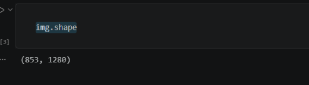
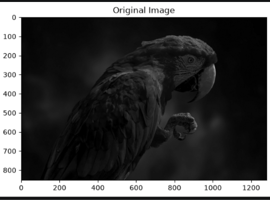
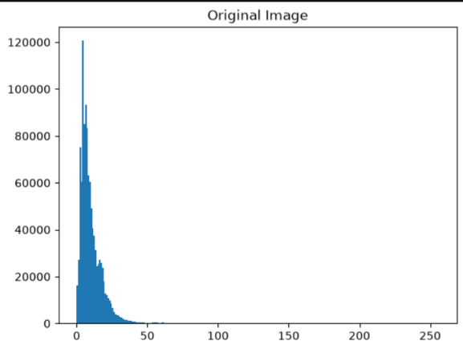
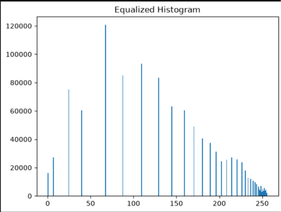
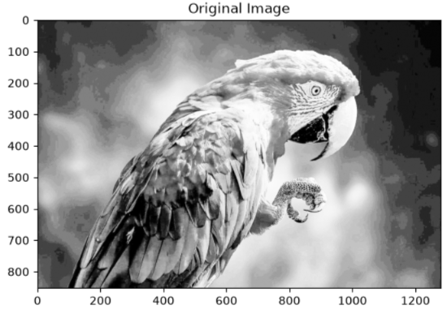
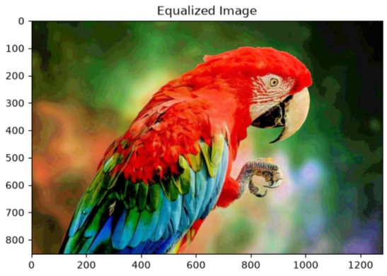
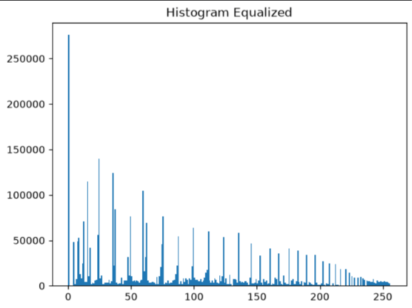

# Histogram Equalization Using OpenCV (Grayscale & Color Images)

## NAME: NARENDRA KRISHNAN KS
## REG.NO:212225240096

## Aim

To write a Python program using OpenCV to perform histogram equalization on both grayscale and color images to enhance image contrast and brightness.

The program performs the following operations:

- Read and display a grayscale image  
- Plot histogram of the grayscale image  
- Apply histogram equalization on grayscale image  
- Read and display a color image  
- Plot histogram of B, G, R channels  
- Convert image to HSV color space  
- Apply histogram equalization on the Value (V) channel  
- Convert the enhanced image back to BGR format  
- Display original and enhanced images with histograms  

## Software Used

- Anaconda – Python 3.7  
- Jupyter Notebook / VS Code  
- OpenCV (`cv2`)  
- NumPy  
- Matplotlib  

---

## Algorithm

### Step 1:
Import the required libraries: OpenCV, NumPy, and Matplotlib.

### Step 2:
Read the image `parrot.jpg` in grayscale format.

### Step 3:
Display the grayscale image and plot its histogram.

### Step 4:
Apply histogram equalization using `cv2.equalizeHist()` to enhance contrast.

### Step 5:
Display original grayscale image, its histogram, enhanced image, and its histogram using a 2 × 2 grid.

### Step 6:
Read the same image in color format.

### Step 7:
Split the image into B, G, R channels and plot their histograms.

### Step 8:
Convert the image from BGR to HSV color space.

### Step 9:
Apply histogram equalization on the V (Value) channel.

### Step 10:
Merge the channels and convert the image back to BGR format.

### Step 11:
Display original color image, histogram, enhanced image, and enhanced histogram using a 2 × 2 grid.

---

## Program

### Developed By:
**Name:** KARNAM PAREESH NAIDU

### Register No:
212225230129
---
## PYHTON CODES AND OUTPUT:
### PROGRAM IMPORTING LIBRARIES:
~~~
import cv2
import numpy as np
import matplotlib.pyplot as plt
~~~
### PROGRAM READING IMAGE:
~~~
img = cv2.imread(r"C:\Users\acer\Downloads\parrot.jpg.jpeg", cv2.IMREAD_GRAYSCALE)
~~~
### PROGRAM:
~~~
img.shape
~~~
### OUTPUT:

### PROGRAM:
~~~
# Display the grayscale image.

plt.imshow(img, cmap='gray')
plt.title('Original Image')
plt.show()
~~~
### OUTPUT:

### PROGRAM:
~~~
plt.hist(img.ravel(),256,range = [0, 256]);
plt.title('Original Image')
plt.show()
~~~
### OUTPUT:

### PROGRAM:
~~~
img_eq = cv2.equalizeHist(img)
plt.hist(img_eq.ravel(), 256, range = [0, 256])
plt.title('Equalized Histogram')
plt.show()

~~~
### OUTPUT:

### PROGRAM:
~~~
plt.imshow(img_eq, cmap='gray')
plt.title('Original Image')
plt.show()
~~~
### OUTPUT:

### PROGRAM FOR IMPORTING IMAGE AND PREPROCESSING:
~~~
img = cv2.imread(r"C:\Users\acer\Downloads\parrot.jpg.jpeg", cv2.IMREAD_COLOR)
--
img_hsv = cv2.cvtColor(img, cv2.COLOR_BGR2HSV)
--
img_hsv[:,:,2] = cv2.equalizeHist(img_hsv[:, :, 2])
--
img_eq = cv2.cvtColor(img_hsv, cv2.COLOR_HSV2BGR)
~~~
### PROGRAM:
~~~
plt.imshow(img_eq[:,:,::-1]); plt.title('Equalized Image');plt.show()
~~~
### OUTPUT:

### PROGRAM:
~~~
# Plot the histogram of colour image
plt.hist(img_eq.ravel(),256,range = [0, 256]); plt.title('Histogram Equalized');plt.show()
~~~
### OUTPUT:

##  Output

### Grayscale Histogram Equalization

- Original grayscale image is displayed  
- Histogram of original grayscale image is plotted  
- Enhanced image after histogram equalization is displayed  
- Histogram of enhanced grayscale image shows improved contrast  

### Color Image Histogram Equalization

- Original color image is displayed  
- Histogram of B, G, R channels is plotted  
- Enhanced image after HSV-based equalization is displayed  
- Histogram of enhanced image shows better intensity distribution  
---
## Result
Thus, histogram equalization is successfully performed on both grayscale and color images using OpenCV. The contrast and brightness of the images are significantly improved, enhancing visual quality and feature visibility.
